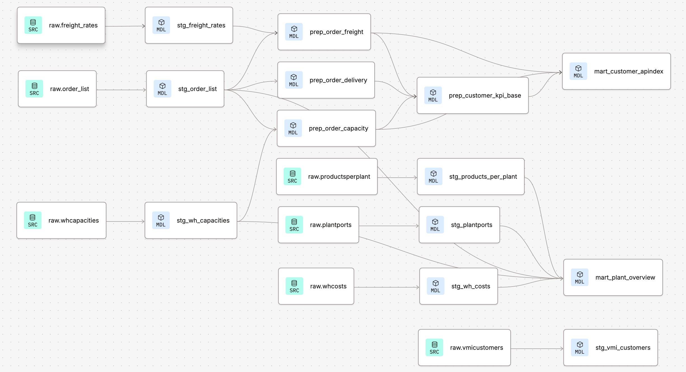

# Status Update 3 — Modeling Phase Results

**Project:** Supply Chain Performance & Decision Intelligence (APIndex) </br>
**Phase:** dbt staging → prep → mart complete; Tableau dashboard in progress

---

## Pipeline Overview

<p align="left">
  
</p>

**Staging → Prep → Mart:** a single source of truth (`mart_customer_apindex`, 46 customers)
that feeds all three stakeholder perspectives in Tableau. A second mart, `mart_plant_overview` (19 plants),
is deliberately kept separate (data blending) to avoid a "fan-out."

---

## Thesis Adjustments During Modeling

Two theses changed shape during the modeling phase — a sign the pipeline is
being stress-tested against real data, not just assumed:

- **Freight Cost Exposure:** started as an absolute cost calculation
  (`weight × rate`); switched to a relative rate-pressure proxy once only
  ~40% of FreightRates lanes turned out to follow a consistent cost pattern.
  Data reliability drove the change, not preference.
- **Customer C46:** started as a suspected data error (extreme freight
  outlier); ended as a validated, structurally explained case — it took six
  diagnostic queries to rule out a thin sample, a join artifact, and a
  bracket-nesting bug before landing on the real explanation.

---

## Insight 1 — Capacity Risk Concentration by Plant

**Thesis:** Capacity Risk in the current index is structurally dominated by a
single plant — 26 of 46 customers share an identical
normalized score, meaning the KPI reflects network concentration more than
individual customer risk.

**Evidence:** A distribution check that revealed the skewed distribution and led to the log transformation. Additionally, the clustering quantification, which identified the 26/46 cluster.

**Sample:**

<details>
<summary>SQL</summary>

```sql
select
    avg_capacity_utilization,
    count(*) as n_customers
from prep_customer_kpi_base
group by avg_capacity_utilization
order by n_customers desc
limit 5;
```

</details>


| avg_capacity_utilization | n_customers |
|---|---|
| 8.4294 | **26** |
| 1.4354	| 3 |
| 8.261544	| 1 |
| 8.4101241573	| 1 |
| 8.3932497537	| 1 |
| ... | ... |


*One utilization value alone accounts for 26 of 46 customers — a single
plant's volume share is the primary driver, not customer-specific behavior.*

**Limitation** This limits the KPI's power to differentiate customers within
that group — worth flagging as an open limitation, not hiding it.

**Why this matters going forward:** the grain tension is exactly why the
dashboard is designed around three separate perspectives rather than one
score — at the Strategic level, network concentration *is* the signal;
at the Operational level, the index still needs to differentiate
individual customer action despite the shared structural component.

---

## Insight 2 — Diagnosing the C46 Freight Outlier

**Thesis:** Customer C46's extreme freight rate is not a data error but a
real, duplicate-bracket rate structure on one lane (PORT09→PORT09) — kept in
the dataset and flagged, not excluded.

**Evidence:** Six-step diagnostic: thin
sample ruled out, lane-level breakdown, bracket-nesting check, mode/transit
pattern check, re-run.

**Sample (Step 2 — lane-level breakdown for C46):**

<details>
<summary>SQL</summary>

```sql
select 
    f.carrier, 
    o.origin_port, 
    o.destination_port, 
    o.service_level, 
    count(*), 
    avg(f.avg_rate)
from prep_order_freight f
join stg_order_list o on f.order_id = o.order_id
where f.customer = 'V555555_6'
group by f.carrier, o.origin_port, o.destination_port, o.service_level
order by count(*) desc;
```

</details>


| Lane | Orders | Avg. rate |
|---|---|---|
| PORT04 → PORT09 (DTP) | 729 | 0.048 (normal) |
| PORT09 → PORT09 (DTP) | 32 | 12.28 (~256x higher) |

*The high average isn't spread across all of C46's orders — it's driven by
32 orders on one specific lane — a deviation that warrants closer investigation rather than simply being smoothed out via averaging.*

**Caveat (working theory, not confirmed by the dataset):** The pattern
(GROUND mode, 0–1 transit days, origin = destination) suggests a local
handling/storage fee rather than standard freight transport — while plausible, this is not explicitly confirmed by any field in the source data.

---

## Outlook

- **Dashboard build:** Tableau, three stakeholder perspectives
  (Operational / Tactical / Strategic) — *work in progress*, directly
  informed by the customer-vs-network tension surfaced in Insight 1.
- **Sensitivity analysis:** planned once the Tableau weighting parameters
  are live, to test how robust these theses are across different KPI
  weighting profiles.
- **VMI customer flag:** staged (`stg_vmi_customers`) but not incorporated
  into the APIndex — not relevant to building the core index, since there
  is no evidence yet that VMI status affects any of the three KPIs.
  Relevance will be assessed after the build via a group-level comparison
  (VMI vs. non-VMI customers on rate, capacity, and delivery); only added
  as a dimension if a clear effect emerges.

</br></br></br></br></br></br></br></br>

<details>
<summary><b> All Theses </b></summary>
 
1. **Freight cost** — relative rate-pressure proxy instead of weight × rate
   (driven by data reliability)
2. **Capacity risk** — plant-level concentration ← *shown as Insight 1*
3. **Index architecture** — normalized KPI components exposed separately
   instead of a fixed composite score
4. **C46 outlier** — diagnosed, not removed ← *shown as Insight 2*
5. **Data completeness** — 13% of customers excluded from the
   tactical/strategic view (incomplete KPI inputs)
