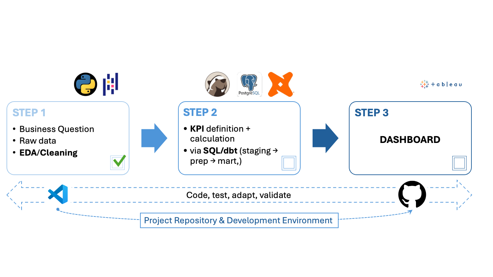

# Stakeholder-Meeting No.1 — Data & Question Set

**Supply Chain Decision Intelligence** · neue fische Data Analytics Bootcamp Capstone

---

## 1. Dataset

**Source:** Dzalbs, I. & Kalganova, T. (2019). *Supply Chain Logistics Problem Dataset (Version 2)*. Brunel University London, Figshare.

7 raw tables, no missing values:

| Table | Rows | Cols | Notes |
|---|---|---|---|
| OrderList | 9,215 | 14 | Single-date snapshot (2013-05-26) |
| FreightRates | 1,540 | 11 | |
| WhCosts | 19 | 2 | |
| WhCapacities | 19 | 2 | Current-state capacity constraints (orders/day) |
| ProductsPerPlant | 2,036 | 2 | |
| VmiCustomers | 14 | 2 | |
| PlantPorts | 22 | 2 | |

  

**Key framing point:** all orders share a single order date — this is a **snapshot**, not a time series. The project is designed as decision support for that point in time, not trend forecasting.

---

## 2. Question Set / Research Angles

**Core question:**
> Which customers represent the greatest operational priority for corrective action, when cost, delivery, and capacity dimensions are considered jointly?

**Supporting angles:**

- **Cost** — Where does freight cost exposure concentrate disproportionately?
- **Reliability** — Which customers are most affected by delivery performance issues?
- **Capacity** — Which customers depend on warehouses operating near capacity limits?
- **Aggregation** — How can these three dimensions be combined into one comparable, customer-level priority signal?
- **Perspective** — Does the resulting priority ranking change depending on which stakeholder view (operational, tactical, strategic) is applied?

**Framing constraint:** as a single-date snapshot, the output is a decision-support signal for this point in time, not a trend forecast.

**Goal:** these angles feed into a single decision-support dashboard — customers ranked by priority, viewable through each stakeholder lens, so action can be targeted rather than reactive.

---

## 3. Why This Dataset

Although structured as an academic dataset, it originates from an industry-funded research collaboration (Brunel University London × Caterpillar Inc.) and reflects realistic plant/port networks, freight structures, and order volumes — closer to real operational data than a purely synthetic simulation. This supports the case that patterns and priorities derived here are transferable, not just illustrative.

---

## 4. Outlook — Planned Workflow

Python/Pandas (EDA, cleaning) → SQL (PostgreSQL) → dbt (staging → prep → mart) → Tableau (dashboard) → GitHub

  

