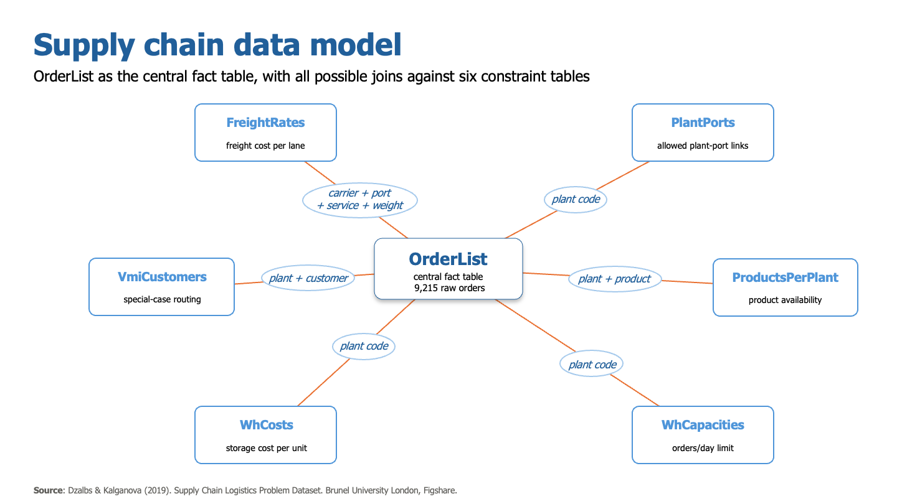
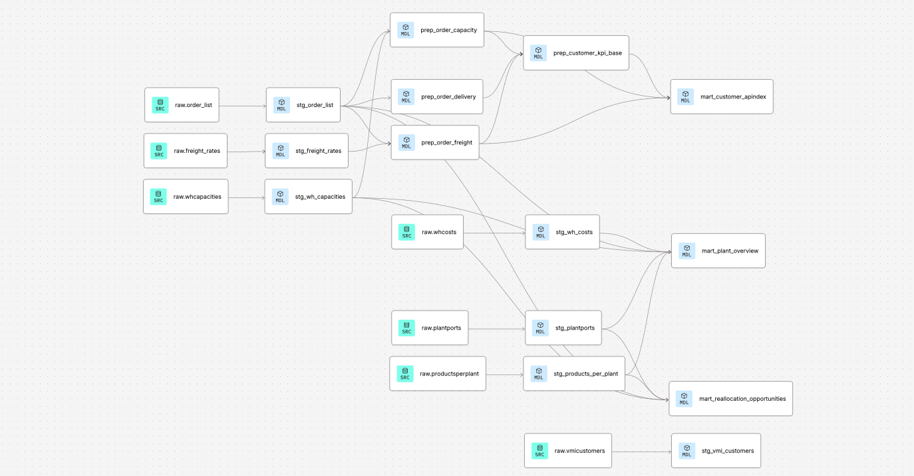
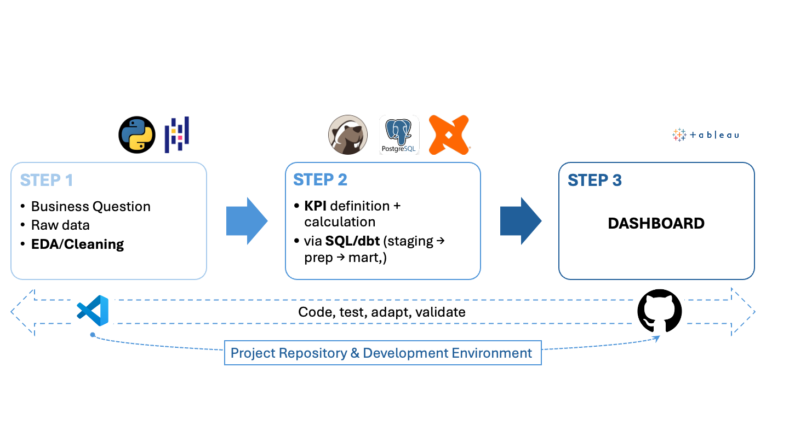

# Supply Chain Decision Intelligence

**Status:** Completed capstone project — neue fische Data Analytics Bootcamp.

This repository documents the development of a Supply Chain Decision Intelligence
framework from data preparation and modeling through validation and an interactive
Tableau decision layer.

## Project Idea 🎯

A BI framework that moves from static reporting toward actionable decision support
for supply chain performance. Three base KPIs — Delivery Reliability, Freight Cost
Exposure, and Capacity Risk — are combined into a weighted Action Priority Index,
calculated per customer and viewed through three stakeholder perspectives
(Operational, Tactical, Strategic). The framework combines a transparent,
adjustable priority score with KPI-level context and a separate operational
reallocation layer. It supports prioritization and scenario discussion; it is
not a predictive model or an automated allocation recommendation.

## Dataset

**Source:** Dzalbs, I. & Kalganova, T. (2019). *Supply Chain Logistics Problem
Dataset (Version 2)<sup> * </sup>. Brunel University London, Figshare.
https://brunel.figshare.com/articles/dataset/Supply_Chain_Logistics_Problem_Dataset/7558679

**Setup:** Download the file and place it at `data/Supply chain logisitcs problem.xlsx`
before running `01_Notebooks/01_Data_eda_cleaning.ipynb`.

**Related publication:** Dzalbs, I., & Kalganova, T. (2020). Accelerating supply
chains with Ant Colony Optimization across a range of hardware solutions.
*Computers & Industrial Engineering*, 147, 106610.

**Structure:** 7 tables —

| Table | Rows | Cols | Notes |
|---|---|---|---|
| OrderList | 9,215 | 14 | Single-date snapshot (2013-05-26) |
| FreightRates | 1,540 | 11 | 3 duplicate rows identified, to be removed |
| WhCosts | 19 | 2 | |
| WhCapacities | 19 | 2 | Current-state capacity constraints (orders/day) |
| ProductsPerPlant | 2,036 | 2 | |
| VmiCustomers | 14 | 2 | |
| PlantPorts | 22 | 2 | |

*Wh = Warehouse | vmi = Vendor Managed Inventory*

<details>
<summary><b> Table Columns </b></summary>

**OrderList**
- Order ID
- Order Date
- Origin Port
- Carrier
- TPT
- Service Level
- Ship ahead day count
- Ship Late Day count
- Customer
- Product ID
- Plant Code
- Destination Port
- Unit quantity
- Weight

**FreightRates**
- Carrier
- orig_port_cd
- dest_port_cd
- minm_wgh_qty
- max_wgh_qty
- svc_cd
- minimum cost
- rate
- mode_dsc
- tpt_day_cnt
- Carrier type

**WhCosts**
- WH
- Cost/unit

**WhCapacities**
- Plant ID
- Daily Capacity

**ProductsPerPlant**
- Plant Code
- Product ID

**VmiCustomers**
- Plant Code
- Customers

**PlantPorts**
- Plant Code
- Port
</details>

<p align="center">
  
</p>

No missing values across any table. Key characteristics established during EDA:

- **Snapshot, not time series:** all 9,215 orders share a single order date;
  trend analysis is out of scope for this dataset.
- **Data-quality cleaning:** duplicate FreightRates rows and zero-weight
  OrderList records were removed during the Pandas cleaning stage, since
  both were identified as part of KPI-input validation and represent
  unambiguous data-quality errors requiring no business interpretation —
  unlike the CRF/V44_3 exclusion below, which is domain-specific and
  therefore handled explicitly in the dbt prep layer.
- **CRF / carrier V44_3:** ~9.3% of orders (854) have no corresponding freight
  rate by design (customer-arranged shipping, confirmed via the dataset authors'
  FAQ) and are excluded from cost calculations.
- **Aggregation level — Customer:** Plant Code and Origin/Destination Port are
  too concentrated (92.7%–100% on a single value) to serve as a meaningful
  primary dimension; Customer (46 unique values, ~10.6% max share) was selected
  instead.
- **Capacity framing:** `WhCapacities` reflects current-state constraints while
  `OrderList` is historical, so capacity analysis is framed as a stress test of
  historical demand against present-day constraints, not a retrospective
  utilization report.
  <br><br><br>
  
<sup> * </sup> The dataset originates from a research collaboration between Brunel University London and Caterpillar Inc. (funded project, Feb–Aug 2015, PI: Prof. Tatiana Kalganova), which also produced the underlying peer-reviewed publication (Dzalbs & Kalganova, 2020, Computers & Industrial Engineering). While the dataset is not explicitly labeled as derived from real Caterpillar operations, the industrial funding context and the structural realism of the data (plant/port networks, freight rate tables, order volumes) suggest it may reflect anonymized real-world logistics patterns rather than a purely synthetic simulation.<br><br>

### dbt Models

The transformation layer follows the standard dbt structure — **staging → prep → mart** —
connected via dbt Cloud to this GitHub repository (`03_dbt`). SQL logic is prototyped
against the Postgres data in DBeaver, then finalized as versioned `.sql` model files and
run/tested through dbt.

### Staging

One model per raw source table (7 total), declared via `sources.yml` against schema
`s_thomasrabe`. Staging performs renaming and type casting only — no business logic, no
filtering, no joins. Column names are unified across tables where the same business
concept appears under different raw labels (e.g. `Plant ID` / `Plant Code` → `plant_code`;
`svc_cd` / `Service Level` → `service_level`; `orig_port_cd` / `dest_port_cd` →
`origin_port` / `destination_port`).

Note: duplicate FreightRates rows and zero-weight OrderList records were already removed
during the Pandas cleaning stage (see EDA notebook), since both were identified as part of
KPI-input validation and represent unambiguous data-quality errors requiring no business
interpretation. The CRF/V44_3 exclusion, by contrast, is a domain-specific decision and is
therefore handled explicitly in the dbt prep layer, not in staging.

### Prep

Combines staging models into business-logic-aware building blocks: the order–freight join
(weight-bracket join on origin/destination port, carrier, and service level), the
order–capacity join (via plant code), and aggregation to the customer level — the primary
analysis grain for the Action Priority Index.

**Freight Cost Exposure note:** a derived cost (`weight × rate`) proved inconsistent
across FreightRates lanes (~40% follow a clean pattern). The KPI therefore uses
the matched `rate`, weighted by order weight, as a relative cost-pressure proxy
rather than an unverifiable absolute cost.

2,218 orders (24.1%) are excluded from this KPI: 854 CRF/V44_3 orders (lane not
present in FreightRates, by design) and 1,364 orders whose weight falls outside
all brackets defined for their specific lane — a data-completeness gap only
visible after performing the join. Where multiple FreightRates rows match an
order (>99% of matched orders), no column in the source data distinguishes
them; `AVG(rate)` is used as a neutral aggregation. Full diagnosis in
`01_Notebooks/02_prep_order_freight_join_diagnosis.md` | `02_SQL/prep_order_freight_diagnostic.sql`

**Delivery Reliability:** `ship_ahead_day_count` and `ship_late_day_count` were
both > 0 for 123 orders (1.3%) — a logical contradiction (cannot be early and
late at once). These are excluded in `prep_order_delivery` rather than netted
out, since a computed 0 would be indistinguishable from a genuinely on-time
delivery. Remaining orders yield `delivery_deviation_days` (late − ahead) and a
categorical `delivery_status`.

### Mart

`mart_customer_apindex` — one row per customer (46), the single source feeding
all three Tableau stakeholder perspectives. Contains normalized (0–1) KPI
inputs for Freight Cost Exposure, Capacity Risk, and Delivery Reliability as
**separate columns**, not a pre-computed composite score — index weighting is
applied in Tableau, keeping it adjustable rather than fixed upstream.

**Normalization:** Freight rate and capacity utilization are log-transformed
before min-max scaling (`ln(x + 1)`), since both are right-skewed. Capacity
utilization in particular is dominated by a single plant (~93% of order
volume), causing 26 of 46 customers to share an identical max value — a
genuine structural tie the log-transform does not (and should not) resolve.
Delivery reliability uses the share of late orders directly (already bounded
[0,1]), no transformation needed.

**Plant dependency:** `is_single_plant_exposed` flags customers whose orders
route through exactly one plant — structural context for the strategic
narrative, independent of the index itself.

**Data completeness:** `has_complete_kpi_data` flags the 6 customers missing
at least one KPI input (4 missing Freight, 2 missing Delivery — see prep
exclusion notes above). These are broken out separately in the operational
view rather than scored with partial data; tactical and strategic views use
only the 40 customers with complete data.

`mart_plant_overview` — one row per plant and the plant-level context layer for
the Tableau model. It combines master-data capacity and unit cost with observed
order volume, share of total order volume, capacity-utilization ratio, customers
served, port connections, supported products, and an active/inactive flag.

In Tableau, `mart_plant_overview` is connected to `mart_customer_apindex`
through a **logical relationship**, not a physical row-level join. This keeps
the different grains intact — plant level versus customer level — and prevents
plant attributes from duplicating customer rows or changing APIndex values.
The relationship adds plant/network context to the customer prioritization;
`mart_customer_apindex` remains the authoritative source for the APIndex.

`mart_reallocation_opportunities` — a separate operational decision-support
mart at the grain customer × product × origin port × current plant × alternative
plant. An alternative plant is structurally eligible only if it supports the
same product, is connected to the same origin port, and differs from the current
plant. The mart ranks alternatives by their observed capacity-pressure context.
It does not feed the APIndex and does not claim that physical spare capacity is
available.

Validation identified 256 unique structural candidates across 23 customers:

- 23 candidates across 13 customers show lower observed capacity pressure at an
  active alternative plant (`Observed Improvement`).
- 225 candidates across 17 customers lead to plants with no observed orders in
  the snapshot (`Unutilized Candidate`). These are network options requiring
  operational confirmation, not evidence of spare capacity.
- 8 candidates across 6 customers lead to higher observed capacity pressure and
  remain visible for transparency rather than as recommended improvements.

No duplicate candidate combinations or join fan-out were found. Full validation:
`02_SQL/reallocation_opportunities_validation.sql`.

<p align="left">
  
</p>

*(Source: Supply Chain Logistics Problem Dataset (Dzalbs & Kalganova, 2019); data preparation and modeling in dbt.)*
</br>
### Statistical Validation

Following coach feedback after the third status update, the two theses
selected for that meeting (Capacity Risk concentration and the C46 freight
outlier) are backed with lightweight statistical tests. These tests validate
properties of the underlying KPI data and are deliberately kept separate from
the model-level APIndex sensitivity analysis below.

- **C46 outlier:** one-sample t-test on order-level freight rate (n = 761)
  against the network mean (excl. C46), order level rather than customer
  level to have a defensible sample size for the test.
- **Capacity concentration:** correlation check (Spearman primary, given the
  known skew and tied values in `avg_capacity_utilization`; Pearson reported
  alongside) between capacity utilization and the other two KPIs, testing
  whether the structural concentration has any measurable spillover.

Full notebook: `01_Notebooks/02_hypothesis_testing.ipynb`.

### Action Priority Index

The APIndex is calculated in Tableau from the three normalized KPI inputs:

`APIndex = (Freight × wF + Capacity × wC + Delivery × wD) / (wF + wC + wD)`

The same 40 customers with a complete three-KPI basis are used across all
perspectives. Only the weighting changes:

| Perspective | Freight | Capacity | Delivery | Decision emphasis |
|---|---:|---:|---:|---|
| Strategic | 20% | 50% | 30% | Structural capacity exposure |
| Tactical | 40% | 20% | 40% | Cost and delivery balance |
| Operational | 20% | 20% | 60% | Immediate delivery performance |

Common thresholds keep the scale comparable across perspectives:

- **Low:** `< 0.30`
- **Medium:** `0.30–<0.60`
- **High:** `≥ 0.60`

These are transparent decision-support boundaries selected after inspecting the
three APIndex distributions. They are not statistically estimated risk cut-offs.
Using a common scale means that a customer's class can change because the
stakeholder weighting changes, not because each perspective uses a different
classification rule.

### APIndex Sensitivity Analysis

The model validation was performed in two steps:

1. `04_APIndex_sensitivity_analysis.ipynb` compares distributions, rankings,
   customer movement and candidate thresholds across Strategic, Tactical and
   Operational views.
2. `05_APIndex_weight_sensitivity.ipynb` reproduces the Tableau APIndex in
   Python and perturbs one KPI weight at a time by ±10 percentage points. The
   remaining two weights are adjusted proportionally so that the total remains
   100%.

The Python reproduction matches Tableau to floating-point precision. Customer
rankings remain highly correlated under the tested weight changes, indicating
that the overall ordering is broadly robust. Priority classes are more
sensitive near the `0.30` and `0.60` boundaries. Increasing the Capacity weight
produces the most class switches because the Capacity KPI contains strong
structural concentration and many tied customer values.

C29 remains a strong priority signal overall, although its Tactical High class
is not invariant. C46 is a useful boundary case: its Tactical baseline lies
just below `0.60`, so moderate weight changes can move it between Medium and
High. APIndex classes should therefore always be read together with the three
underlying KPI values.

**Conclusion:** the APIndex is suitable as a transparent prioritization aid.
Its ranking is broadly robust to moderate weight changes, while categorical
labels near the chosen thresholds should be treated as directional rather than
deterministic.

### Tableau Decision Layer

Tableau is the presentation and interaction layer rather than a second data-
transformation layer. It receives the normalized KPI columns from
`mart_customer_apindex`, plant-level context from `mart_plant_overview`, and
the structurally validated alternatives from
`mart_reallocation_opportunities`. The Plant Overview is related logically to
the APIndex mart so Tableau can query each table at its native grain.

The intended interaction flow is:

1. Select a stakeholder perspective (Strategic, Tactical, Operational).
2. Apply the corresponding weight profile to the three normalized KPIs.
3. Rank complete-data customers by APIndex and classify them as Low, Medium or
   High using the common thresholds.
4. Inspect the KPI composition behind the score, especially for customers near
   a threshold.
5. Add plant-level capacity, cost and network context through the related Plant
   Overview without recalculating the customer APIndex.
6. Use the operational reallocation view as a separate drill-down for eligible
   customer/product combinations; treat `Unutilized Candidate` as requiring
   confirmation, not as a recommendation.

The six customers with incomplete KPI data remain visible as a separate data-
completeness group and are not assigned a partial APIndex. This prevents a low
score from being confused with missing evidence.

## Workflow

Python/Pandas (EDA and cleaning) → SQL/PostgreSQL (diagnosis and prototyping) →
dbt Cloud (staging → prep → marts and tests) → Python (statistical and model
validation) → Tableau (stakeholder perspectives and operational drill-down) →
GitHub (versioned code, documentation and outputs)

<p align="center">
  
</p>

## Repository Structure

```
01_Notebooks/             Jupyter notebooks
02_SQL/                   SQL deliverables
03_dbt/                   dbt models
04_Dashboard/             Tableau workbook / exports
05_Stakeholder_meetings/  status presentations  
data/                     Raw dataset (gitignored, not versioned – see setup instructions)
images/                   png files

```

## Current Progress

### Step 1 Python/Pandas
- [x] Business Question
- [x] Raw data
- [x] EDA/Cleaning

### Step 2 SQL/dbt
- [x] KPI/Index definition
- [x] KPI-input calculation and normalization
- [x] dbt models
  - [x] staging
  - [x] prep
  - [x] customer APIndex mart
  - [x] plant overview mart
  - [x] reallocation-opportunity mart
- [x] Reallocation candidate validation

### Step 3 Validation
- [x] Statistical validation of Capacity Risk and C46 theses
- [x] APIndex distribution and threshold assessment
- [x] Tableau/Python APIndex reproduction check
- [x] Weight sensitivity analysis (±10 percentage points)

### Step 4 Tableau and Presentation
- [x] Stakeholder weight profiles and common priority thresholds
- [x] Final Tableau dashboard/story
- [x] Integrate reallocation drill-down and data-completeness view
- [x] Final presentation (deadline: September 29)
